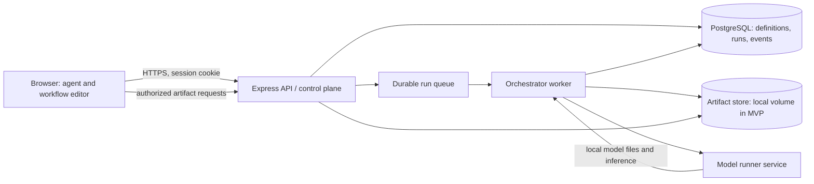

# AI orchestration MVP design

## Purpose

Define a proof-of-concept architecture for creating reusable AI agents, composing them into workflows, and executing workflows whose later agents consume earlier agents' outputs. The example workflow creates a character image, a background image, and speech audio, then passes those artifacts and a description to a video-generation agent.

This is a design proposal, not a statement that all capabilities already exist. The repository has a React 19/Vite/Mantine web app, an Express 5 TypeScript API, PostgreSQL 17 with Drizzle, and Google sign-in. Agent definitions now have an initial authenticated CRUD slice; workflow execution, jobs, and artifact storage remain unimplemented. Existing Docker Compose currently runs PostgreSQL only.

## MVP goals and boundaries

The MVP should demonstrate that a signed-in user can:

1. Create, edit, list, and delete reusable agent definitions.
2. Assemble a directed workflow from those agents, connect typed outputs to typed inputs, and save/edit/reuse it.
3. Start a run with a textual prompt and optional files, observe its state and per-agent progress, and inspect/download generated outputs.
4. Run supported inference locally, without per-request hosted-model API charges.

Keep the first release to one deployment host, one user-owned workflow space per account, a small allow-listed set of local model runtimes, sequential dependency execution, and common text/image/audio/file inputs and outputs. It is acceptable to execute independent ready nodes concurrently if capacity permits, but concurrency is not a user-facing tuning surface in the first cut.

Out of scope: arbitrary user code or plugins, public workflow sharing, collaborative editing, billing/quotas, autoscaling, distributed GPU scheduling, production-grade video generation, model training/fine-tuning, and guarantees that any particular model can produce every modality. Validate one end-to-end workflow with models and hardware actually available before promising the video example.

## Recommended architecture

Use the browser as the workflow editor and run viewer, the existing API as the authenticated control plane, PostgreSQL as the durable metadata store, a background worker as the orchestrator, and separately isolated local model runner containers as inference backends.

### Components and responsibilities

- **Web app:** Agent management forms, visual workflow builder, validation feedback, run history and live status. Do not send model weights or inference requests directly from the browser in the default design.
- **API/control plane:** Existing Express app. Enforce session authentication and ownership on every agent, workflow, run, and artifact request. Validate workflow structure and runner configuration. Create an immutable workflow snapshot and queued run transactionally.
- **Queue and worker:** A queue decouples potentially long GPU/CPU work from HTTP request lifetimes. For an initial single-host POC, use PostgreSQL-backed jobs with row locking/`SKIP LOCKED` and leases, or add a small Redis-backed queue if operational simplicity proves better. Avoid an in-memory queue because restarts would lose queued work. One worker process is sufficient initially.
- **Orchestrator:** Validates the graph, schedules nodes whose dependencies are satisfied, resolves their input bindings, calls the appropriate runner adapter, stores output artifacts, and records node/run state. Retries only transient failures with a small bounded policy; never retry a node indefinitely.
- **Model runners:** Containerized, allow-listed inference services with explicit model/runtime adapters. Keep runners off the public network and expose only to the worker on a private Compose network. Runners should not access the database or have credentials to the artifact store. The worker transfers input files through a controlled local interface and validates output paths and sizes.
- **Artifact store:** A storage interface called by the API/worker. Start with a dedicated Docker named volume or host-managed data directory mounted only where required. Persist metadata in PostgreSQL and bytes in the store; do not put large binary payloads in database rows.

The current Compose stack only starts PostgreSQL. For local development, add worker/runner services behind Compose profiles or provide documented host-run alternatives. Do not assume Docker Compose on an arbitrary laptop can expose a GPU: GPU passthrough and driver/runtime support depend on OS and hardware. Begin with CPU-capable small models or a verified GPU development environment.

### Workflow execution model

Represent a workflow as a directed acyclic graph (DAG). Each node references an agent definition and has a stable node ID. Each edge/binding maps one node output (or run input) to one declared input on another node. Validate that:

- all references belong to the workflow and are available to the current user;
- there are no cycles, missing required inputs, incompatible media types, or unsupported settings;
- the selected runner/model supports the declared task and modalities;
- input and output limits fit configured resource constraints.

At run creation, copy the workflow definition, agent configuration, and relevant runner/model identifiers into a versioned run snapshot. Later edits to an agent or workflow must not change an already queued or running job. Execution states should be explicit: `queued`, `running`, `succeeded`, `failed`, `cancel_requested`, and `cancelled`; node states should also include `skipped`. Persist transitions and user-readable error summaries. A browser can poll a run endpoint at modest intervals for MVP; add server-sent events when polling becomes noticeably wasteful. Cancellation is cooperative: stop scheduling new nodes, signal the active runner if supported, then mark the run cancelled.

Initial node execution can be sequential topological order. Independent nodes may be run concurrently later, but enforce a worker-wide concurrency limit and per-run/resource limit so a graph cannot exhaust local memory or GPU VRAM.

### Local inference and the browser alternative

**Recommended MVP: worker-to-local-runner containers.** This keeps model execution independent from browser lifecycle, works when the user closes the tab, provides a predictable API contract, and makes model files reusable across runs. “No API cost” means no hosted inference fee; it does not mean zero operating cost. Local inference still uses electricity, CPU/GPU/RAM/storage, model downloads, and may have license or redistribution conditions. Model licenses and acceptable commercial use must be checked before selecting models.

**Browser inference is an optional experiment, not the main execution target.** WebGPU/WebAssembly-based inference can avoid server hardware and may suit small text or image models on supported clients. However, it shifts compute and model downloads to each user's device, has browser/device compatibility and memory constraints, can be slow for large generative models, and cannot reliably finish after the tab closes. Large video models are especially unsuitable as a baseline browser requirement. If prototyped later, treat the browser as a runner adapter that reports capabilities and sends result artifacts to the API; keep workflow definitions and orchestration server-side so graphs remain portable.

**Do not execute arbitrary agent-supplied code in a container.** Agents in this MVP are declarative configurations selecting a supported task, model, and bounded parameters. Container isolation is defense in depth, not a substitute for allow-listing. Do not mount the Docker socket, host home directory, or secrets into inference runners. Set CPU/memory limits, network policy, timeouts, file-size limits, and non-root users where supported.

### Storage choice

Amazon S3 is not required for a single-host POC. Use a storage abstraction and local persistent volume first; define artifact IDs and metadata so the backend can later switch to S3-compatible object storage without changing workflow semantics. Keep an artifact's generated opaque key separate from its original display name. Serve downloads through authenticated API routes (or short-lived signed URLs after migration), never expose the storage volume as a public static directory.

Move to S3 or an equivalent object store when deploying multiple API/worker hosts, needing durable off-host backups, retaining large outputs, or serving artifacts independently of the application host. Plan retention and deletion from the beginning: workflow deletion should not silently erase run history, while an explicit data-retention process can remove artifact bytes and mark metadata expired. Configure size caps and free-space monitoring even on a local volume.

## Data model proposal

Use UUID primary keys, `created_at`/`updated_at` timestamps, foreign keys, and indexes on owner and status fields. The existing `users` table is the ownership root. The table names below are conceptual; adapt Drizzle naming to the codebase conventions.

| Table | Important fields | Purpose |
|---|---|---|
| `agents` | `id`, `user_id`, `name`, `description`, `task_type`, `runner_type`, `model_id`, `config_json`, `input_schema_json`, `output_schema_json`, `created_at`, `updated_at`, `archived_at` | Reusable, declarative agent configuration. Keep secrets out of JSON. Model IDs must refer to allow-listed locally installed/downloaded models. |
| `workflows` | `id`, `user_id`, `name`, `description`, `current_version`, `created_at`, `updated_at`, `archived_at` | Stable workflow identity and ownership. |
| `workflow_versions` | `id`, `workflow_id`, `version`, `definition_json`, `created_at` | Immutable saved DAG versions containing node IDs, agent references/config snapshots, edges, and workflow input schema. Unique `(workflow_id, version)`. JSON avoids premature graph table complexity; consider normalized nodes/edges after query needs emerge. |
| `workflow_version_agents` | `workflow_version_id`, `agent_id` | Relational references from each immutable workflow version to every agent it uses. The agent foreign key uses `ON DELETE RESTRICT`, so saved workflows cannot silently lose a referenced agent. |
| `runs` | `id`, `user_id`, `workflow_id`, `workflow_version_id`, `status`, `input_json`, `snapshot_json`, `error_summary`, `started_at`, `finished_at`, `created_at`, `cancel_requested_at` | Execution instance tied to an immutable definition snapshot. Keep large input files as artifact references. |
| `run_nodes` | `id`, `run_id`, `node_id`, `agent_id`, `status`, `resolved_input_json`, `output_json`, `attempt_count`, `error_code`, `error_summary`, `started_at`, `finished_at` | Per-agent execution state and typed references to outputs. Unique `(run_id, node_id)`. Avoid storing binary output data inline. |
| `artifacts` | `id`, `user_id`, `run_id`, `run_node_id`, `storage_key`, `media_type`, `byte_size`, `checksum`, `display_name`, `status`, `created_at`, `expires_at` | Metadata for user uploads and generated files. Use opaque storage keys; validate media type and size. Add nullable run references for user-uploaded inputs. |
| `run_events` (optional for first cut) | `id`, `run_id`, `sequence`, `event_type`, `payload_json`, `created_at` | Durable progress/event history if node state alone is insufficient for UI updates or recovery. Can be deferred until event details are required. |

Use cascading deletes for user-owned definitions only where semantics are clear. Prefer archiving agents/workflows so historical runs remain readable. Agent deletion must be rejected when any workflow version references it; enforce this in both the API and a restrictive foreign key. Enforce ownership in API queries and, if the product becomes multi-tenant beyond individual user ownership, consider PostgreSQL row-level security as an additional safeguard. Do not rely on unguessable UUIDs as authorization.

### Suggested API surface

- `GET/POST /api/agents`, `GET/PATCH/DELETE /api/agents/:id`
- `GET/POST /api/workflows`, `GET/PATCH/DELETE /api/workflows/:id`
- `POST /api/workflows/:id/validate` returns graph and model capability errors
- `POST /api/workflows/:id/runs` accepts a version and input/artifact references; returns run ID and queued state
- `GET /api/runs`, `GET /api/runs/:id`, `POST /api/runs/:id/cancel`
- `GET /api/runs/:id/events` or status polling for progress
- `GET /api/artifacts/:id` streams bytes after ownership authorization

Validate request and persisted JSON with Zod schemas. Set request body and upload limits. For uploads, use multipart streaming or a separate upload endpoint rather than large base64 JSON payloads.

## Reliability, security, and operational scope

- Create the run record and durable queue item atomically, preferably in one PostgreSQL transaction. Use a lease/heartbeat so a worker crash allows a stuck job to be reclaimed.
- Make node calls idempotent where feasible. Record attempt numbers and avoid creating duplicate artifact metadata on retry.
- Add a hard maximum run duration, per-node timeout, output byte cap, and a user-level limit on queued/running runs.
- Do not log prompts, uploaded content, cookies, session IDs, or secrets by default. Provide useful redacted error messages and operational logs.
- Authenticate API calls with the existing HTTP-only session. Apply ownership checks to workflow, run, and artifact reads as well as writes. Protect cookie-authenticated mutations against CSRF (same-site policy plus origin/CSRF validation appropriate to deployment).
- Validate uploads by byte size and detected content type, use generated filenames, and prevent path traversal. Consider malware scanning before accepting untrusted shared files; public sharing is out of MVP scope.
- Keep internal runner endpoints private, authenticated with short-lived internal credentials if they cross a trust boundary, and never let model output select arbitrary filesystem paths or network destinations.
- Back up PostgreSQL and the artifact volume together. A database-only backup cannot restore usable runs if the corresponding bytes are lost.
- Expose health checks for database, worker queue/heartbeat, artifact storage capacity, and runner readiness. Record model/runtime versions to aid reproducibility.

## MVP delivery sequence

1. **Feasibility spike:** Pick one local model/runtime per needed modality, verify license, hardware footprint, container support, latency, and artifact transfer. Demonstrate one text-to-image or text-to-audio node end to end. Do not make video a launch dependency until a locally runnable model is proven on target hardware.
2. **Definitions:** Add agent CRUD, workflow DAG editor/serialization, schemas, and graph validation. Save immutable workflow versions.
3. **Execution:** Add durable queue/worker, one runner adapter, run/node records, bounded retries, progress UI, and cancellation request handling.
4. **Artifacts:** Add upload and generated-output storage in a persistent local volume, authorized download, size limits, and cleanup policy.
5. **Representative chain:** Connect two or more agents with an image/audio artifact to a downstream supported model; document resource requirements and known model limitations.

## Decisions to revisit after the POC

- PostgreSQL polling queue versus Redis/other broker based on throughput and worker reliability needs.
- Local volume versus S3-compatible object storage based on deployment topology, backup, and artifact volume.
- Whether browser WebGPU is worth a separate runner adapter for small models.
- Whether workflow nodes/edges should become normalized tables for collaborative editing, querying, or version diffs.
- Whether deployments require per-user resource quotas, multiple workers, GPU scheduling, or paid hosted-model fallbacks.

## Assumptions and open questions

- Assumption: “offline agents” means models run on hardware controlled by the deployment, not that model files are available without an initial download.
- Assumption: the MVP is deployed as a single-host POC and prioritizes zero hosted inference fees over high availability.
- Open question: what hardware is the initial target (CPU only, NVIDIA GPU, Apple Silicon, or mixed)? This determines the viable model set and whether GPU-enabled containers are realistic.
- Open question: which model families and commercial/license requirements are acceptable? Run a model and license feasibility spike before committing to image/audio/video scope.
- Open question: are agents strictly reusable prompt/model configurations, or should users eventually provide external credentials/tools? The MVP design excludes user code and arbitrary tools.
